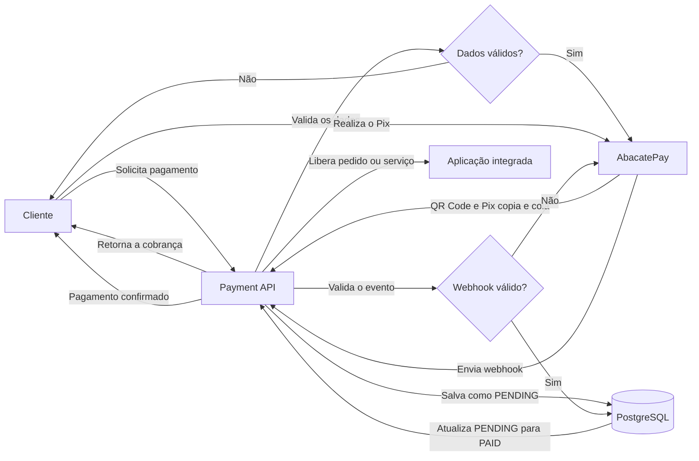

# 🥑 AbacatePay Payment API


API REST para processamento de pagamentos Pix por meio da AbacatePay.

A aplicação cria cobranças, retorna o QR Code e o código Pix copia e cola, registra as transações no PostgreSQL e acompanha automaticamente a confirmação do pagamento.

## 🔄 Fluxo completo do pagamento



A criação e a confirmação são etapas independentes:

```text
CREATED → PENDING → PAID
                    ↘ EXPIRED
                    ↘ REFUNDED
```

O pagamento começa como `PENDING`. Após o cliente realizar o Pix, a AbacatePay envia um webhook para a Payment API, que valida o evento e atualiza automaticamente o status para `PAID`.

## ✨ Recursos

- Criação de cobranças Pix
- QR Code e Pix copia e cola
- Consulta de pagamentos por ID
- Persistência no PostgreSQL
- Confirmação automática por webhook
- Validação e tratamento de erros
- Health check com Spring Boot Actuator
- Rastreamento com `trace_id` e `span_id`
- Documentação com Swagger

## 🔗 Endpoints

```http
POST /payments/pix
GET  /payments/{id}
POST /webhooks/abacatepay
GET  /actuator/health
```

## 🛠️ Tecnologias

`Java 21` · `Spring Boot 4` · `PostgreSQL` · `JPA` · `WebClient`  
`OpenTelemetry` · `Micrometer Tracing` · `Actuator` · `Swagger` · `Maven`

## 📌 Progresso

- [x] Cria Persistência e consulta
- [x] Observabilidade e health check
- [ ] Confirmação automática por webhook
- [ ] Devolução de pagamentos
- [ ] Testes automatizados
- [ ] Docker e deploy

## 👨‍💻 Autor

Desenvolvido por **Cauã Dantas Barbosa** 